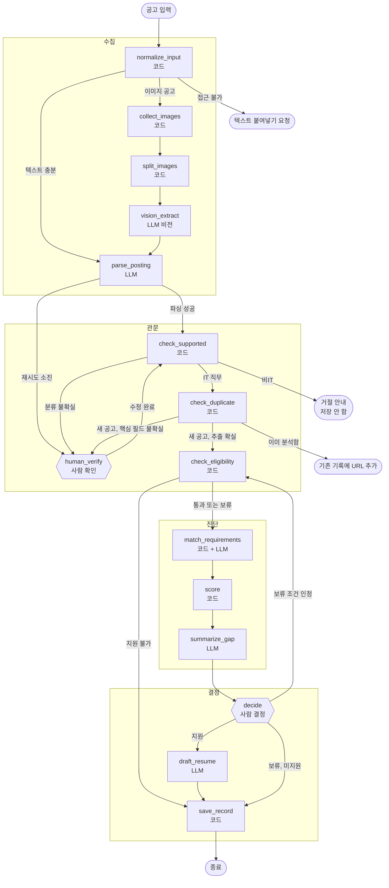
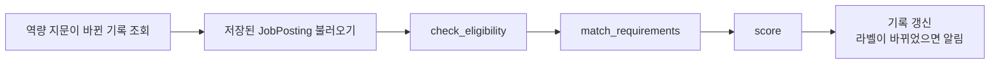
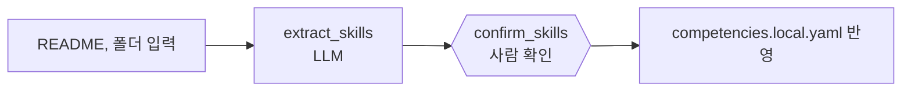

# AGENT DESIGN — fitcheck 에이전트 설계도

> 기준: [SPEC.md](SPEC.md) 4장 · 구현 작업: [TASKS.md](TASKS.md) T7 ~ T13 · 작성: JJonyeok
> 이 문서는 Spec의 "무엇을"을 "어떻게 연결하나"로 바꾼 것이다. 노드 이름, 상태 필드, 분기 함수 이름은 코드와 그대로 맞춘다.

---

## 1. 한 장 요약

> 각 설계를 왜 이렇게 했는지는 [DESIGN_DECISIONS.md](DESIGN_DECISIONS.md) (D1 ~ D14)


- 그래프는 **4개 구간**으로 나뉜다: 수집(Ingest) → 관문(Gate) → 진단(Assess) → 결정(Decide)
- LLM을 부르는 노드는 **6개**뿐이다: `vision_extract`, `parse_posting`, `match_requirements`, `summarize_gap`, `draft_resume`, (별도 그래프) `extract_skills`
- 판정(지원 가능 여부, 충족률, 라벨)은 **전부 코드 노드**다
- 사람을 기다리는 지점은 **2곳**: `human_verify`(추출이 불확실할 때), `decide`(지원 결정)
- 되돌아가는 길은 **2개**: 보류 조건 인정 → `check_eligibility`, 추출값 수정 → `check_supported`
- 비IT, 중복, 지원 불가 공고는 **진단 구간에 들어가기 전에 끝난다** (LLM 비용 없음)

## 2. 전체 그래프



## 3. 구간별 역할

| 구간 | 노드 | 하는 일 | 끝나는 경우 |
|---|---|---|---|
| 수집 | `normalize_input` ~ `parse_posting` | 어떤 형태로 들어오든 `JobPosting` 하나로 만든다 | URL 접근 불가 |
| 관문 | `check_supported` ~ `check_eligibility` | 분석할 가치가 있는지, 지원할 수 있는지 거른다 | 비IT, 중복, 지원 불가 |
| 진단 | `match_requirements` ~ `summarize_gap` | 얼마나 맞는지, 뭐가 부족한지 계산한다 | 없음 |
| 결정 | `decide` ~ `save_record` | 사람이 정하고, 기록으로 남긴다 | 항상 여기서 끝 |

구간을 나눈 이유: **재판정** 작업은 저장된 `JobPosting`으로 관문의 `check_eligibility`부터 진단 구간만 다시 돌리면 된다 (6장). 수집 구간을 다시 타지 않으므로 파싱 비용이 들지 않는다.

## 4. 상태 설계

### 4.1 필드와 쓰는 노드

한 필드는 **한 노드만 쓴다**. 예외는 `llm_calls`(누적)와 `overrides`(사람이 추가)뿐이다.

| 필드 | 쓰는 노드 | 읽는 노드 | 비고 |
|---|---|---|---|
| `input_type`, `input_url`, `input_text`, `input_image_paths` | (시작 입력) | `normalize_input` | |
| `normalized_text`, `text_is_sufficient` | `normalize_input` | `parse_posting`, 분기 | |
| `image_chunks` | `split_images` | `vision_extract` | `collect_images`는 원본 경로를 `input_image_paths`에 채움 |
| `content_hash` | `normalize_input` | `parse_posting`(캐시), `check_duplicate` | 이미지 공고는 `vision_extract` 후 다시 계산 |
| `posting` | `parse_posting`, `human_verify`(수정) | 이후 전부 | `human_verify`는 사람이 고친 값으로 교체 |
| `supported`, `unsupported_reason` | `check_supported` | 분기 | |
| `needs_human_check` | `parse_posting`, `check_supported` | `human_verify` | 확인받을 필드 목록 |
| `eligibility` | `check_eligibility` | `score`, `decide`, 분기 | |
| `matches` | `match_requirements` | `score`, `draft_resume` | |
| `gap_report`, `education_tier`, `fit_band`, `preferences` | `score` | `summarize_gap`, `decide`, `save_record` | |
| `gap_summary` | `summarize_gap` | `decide` | **추가 필요** (현재 `GapReport.summary`와 통합 검토) |
| `overrides` | `decide`(사람 입력) | `check_eligibility` | 누적 (리듀서: 합집합) |
| `decision` | `decide` | 분기, `save_record` | |
| `resume_draft` | `draft_resume` | `save_record` | |
| `application` | `save_record` | (종료) | |
| `llm_calls` | LLM 노드 전부 | `LLMBudget` | 누적 (리듀서: 덧셈) |
| `end_reason` | 종료 직전 노드 | API, 화면 | **추가 필요**: `input_unreachable`, `unsupported`, `duplicate`, `saved` |
| `error` | 실패한 노드 | API, 화면 | **추가 필요**: 사람이 읽을 수 있는 실패 사유 |

### 4.2 리듀서

LangGraph는 기본적으로 노드가 반환한 값으로 필드를 **덮어쓴다**. 누적해야 하는 두 필드만 리듀서를 둔다.

```python
from typing import Annotated
import operator

def union(a: list[str] | None, b: list[str] | None) -> list[str]:
    return sorted(set(a or []) | set(b or []))

class GraphState(TypedDict, total=False):
    llm_calls: Annotated[int, operator.add]      # 노드는 이번에 쓴 횟수만 반환
    overrides: Annotated[list[str], union]       # 인정한 조건이 쌓임
    ...
```

### 4.3 저장 위치

| 무엇 | 어디 | 수명 |
|---|---|---|
| 실행 중 상태 | LangGraph SQLite 체크포인터 | 그래프 종료 후 30일 보관 후 삭제 |
| 파싱 결과 | `postings` 테이블 + 파싱 캐시 | 영구 (재판정에 사용) |
| 지원 기록 | `records` 테이블 | 영구 |
| 원본 이미지 조각 | `data/captures/<thread_id>/` | `human_verify`가 끝나면 원본만 남기고 조각 삭제 |

`thread_id`는 분석 요청마다 새로 만든다 (`uuid4`). 같은 공고를 다시 넣어도 새 thread가 생기지만, `check_duplicate`에서 바로 끝나므로 비용이 없다.

## 5. 분기 함수

분기는 **상태만 보고 결정하는 순수 함수**로 만든다. LLM을 부르지 않고, 단위 테스트로 모든 경로를 확인한다.

```python
def route_after_normalize(s) -> Literal["parse_posting", "collect_images", "__end__"]:
    if s.get("error"):                  return "__end__"            # 접근 불가
    if s["text_is_sufficient"]:         return "parse_posting"
    return "collect_images"

def route_after_parse(s) -> Literal["check_supported", "human_verify"]:
    return "human_verify" if s.get("error") == "parse_failed" else "check_supported"

def route_after_supported(s) -> Literal["check_duplicate", "human_verify", "__end__"]:
    verdict = s["supported_verdict"]    # check_supported의 "supported" | "verify" | "unsupported"
    return {"supported": "check_duplicate", "verify": "human_verify", "unsupported": "__end__"}[verdict]

def route_after_duplicate(s) -> Literal["check_eligibility", "human_verify", "__end__"]:
    if s.get("end_reason") == "duplicate": return "__end__"
    return "human_verify" if s["posting"].meta.low_confidence_fields else "check_eligibility"

def route_after_eligibility(s) -> Literal["match_requirements", "save_record"]:
    return "save_record" if s["eligibility"].status == "ineligible" else "match_requirements"

def route_after_decide(s) -> Literal["check_eligibility", "draft_resume", "save_record"]:
    d = s["decision"]
    if d == "override": return "check_eligibility"
    if d == "apply":    return "draft_resume"
    return "save_record"                # hold, skip
```

`decision`에 `"override"` 값을 추가해야 한다 (현재 `apply | skip | hold`). `supported_verdict` 필드도 추가한다.

**무한 루프 방지**: `human_verify → check_supported` 경로는 같은 thread에서 최대 2회. 두 번째에도 불확실하면 `low_confidence_fields`를 비우고 사람이 확인한 값으로 진행한다. `override` 루프는 인정할 보류 조건이 남아 있을 때만 가능하므로 유한하다.

## 6. 멈춤 지점 (interrupt)

멈출 때 화면에 보내는 데이터와, 재개할 때 받는 데이터의 형식을 고정한다. API(T14)와 화면(T15)은 이 형식만 알면 된다.

### 6.1 `human_verify`

**보내는 것**
```json
{
  "kind": "verify",
  "reason": "parse_failed | low_confidence | category_unsure",
  "fields": [
    {
      "field": "experience",
      "current": {"level": "경력", "min_years": null},
      "source_snippet": "경력 3년 이상 또는 이에 준하는 역량",
      "source_image": "captures/<thread_id>/chunk_02.png",
      "bbox": [0, 340, 860, 420]
    }
  ]
}
```

**받는 것**
```json
{ "fields": { "experience": {"level": "신입/경력", "min_years": null, "preferred_only": true} } }
```

- `source_image`와 `bbox`는 이미지 공고일 때만. 화면은 해당 영역을 잘라 보여준다.
- 받은 값은 `JobPosting` 스키마로 검증하고, 실패하면 다시 멈춘다.

### 6.2 `decide`

**보내는 것**
```json
{
  "kind": "decide",
  "band": "불합격권",
  "coverage": 0.7,
  "checks": [{"id": "자격증:정보처리기사", "kind": "자격증", "label": "정보처리기사", "result": "hold", "detail": "..."}],
  "matches": [{"text": "Python", "status": "matched", "evidence": ["oh-my-agents"], "is_required": true}],
  "preferences": "선호 2/3 (1개는 공고에 정보 없음)",
  "gap_summary": "...",
  "already_applied": [{"title": "데이터 분석가", "status": "탈락", "at": "2026-09"}],
  "deadline": {"date": "2026-11-05", "soon": false}
}
```

**받는 것** (셋 중 하나)
```json
{ "decision": "override", "condition_ids": ["자격증:정보처리기사"] }
{ "decision": "apply" }
{ "decision": "hold" }   // 또는 "skip"
```

- `override`의 `condition_ids`는 현재 보류 중인 조건 id만 허용. 아니면 거부하고 다시 멈춘다.
- 사람이 며칠 뒤에 결정해도 체크포인터에서 그대로 이어진다.

## 7. LLM 호출 계약

모든 LLM 노드는 **입력 범위, 출력 스키마, 금지 사항**을 고정한다. 프롬프트 본문은 `fitcheck/prompts/<노드>.md`에 두고 버전을 붙인다.

| 노드 | 넣는 것 | 받는 것 (스키마) | 금지 사항 | 호출 수 |
|---|---|---|---|---|
| `vision_extract` | 이미지 조각 1개 | `{text: str, uncertain_lines: list[int]}` | 요약, 재구성 금지. 보이는 글자 그대로 | 조각 수 (최대 8) |
| `parse_posting` | 정규화 텍스트, 직무 분류 목록 | `JobPosting` | 공고에 없는 값 추측 금지. 직무는 담당업무 기준 | 1 (+재시도 최대 2) |
| `match_requirements` | 요건 목록 + **후보 프로젝트의 역할, 기여만** | `list[{req_index, status, evidence_ids, note}]` | 후보 밖 프로젝트 언급 금지. 근거 없으면 missing | 1 (요건 전체를 한 번에) |
| `summarize_gap` | 코드가 계산한 라벨, 충족률, 부족 요건 | `{summary: str}` (2문장 이내) | 넘겨받지 않은 숫자, 라벨 생성 금지 | 1 |
| `draft_resume` | 공고 요건, matched 요건과 근거 프로젝트 | `list[{project_id, order, emphasis}]` | 역량 DB에 없는 경험 생성 금지 | 1 |

**코드가 LLM 출력을 다시 검사하는 항목**
- `match_requirements`: `evidence_ids`가 후보 목록에 없으면 해당 판정을 missing으로 강등
- `summarize_gap`: 출력에 나온 숫자가 입력 숫자 집합에 없으면 문장 폐기 후 코드가 만든 기본 문장 사용
- `draft_resume`: `project_id`가 역량 DB에 없으면 그 항목 제거
- `parse_posting`: `job_category`가 분류 목록 밖이면 `기타` + 분류 불확실 처리

## 8. 실패 처리

| 상황 | 처리 | 사용자에게 보이는 것 |
|---|---|---|
| URL 접근 불가, 로그인 필요 | 종료 (`end_reason=input_unreachable`) | "이 페이지는 열 수 없어요. 공고 내용을 붙여넣어 주세요." |
| 파싱 스키마 검증 실패 | 오류 내용을 넣어 재시도 2회 → `human_verify` | 확인 화면 |
| LLM 응답 시간 초과, 일시 오류 | 같은 호출 1회 재시도 (호출 수에 포함) → 실패 시 `error` 기록 후 멈춤 | "분석 중 문제가 생겼어요. 다시 시도할 수 있어요." |
| 호출 상한 초과 (`BudgetExceeded`) | 그 자리에서 `human_verify` 또는 종료 | "이 공고는 너무 길어서 일부만 분석했어요." |
| 이미지 조각 8개 초과 | 앞 8개만 사용, 추출 신뢰도 낮음 | 확인 화면에서 해당 필드 표시 |
| 사람 입력 형식 오류 | 거부하고 다시 멈춤 | 입력 화면에 오류 표시 |

**재개 가능성**: 모든 실패는 체크포인터에 상태가 남은 채로 멈춘다. 같은 `thread_id`로 다시 실행하면 실패한 노드부터 이어진다.

## 9. 별도 작업 (메인 그래프 밖)

### 9.1 재판정 `rejudge`

- 메인 그래프의 노드 함수를 그대로 재사용한다 (그래프만 다름). 파싱은 하지 않는다.
- 저장된 `overrides`를 그대로 반영한다.
- 공고 1건당 LLM 호출: 매칭 1회 (후보가 없으면 0회).

### 9.2 역량 추출 `extract_skills`

- 후보마다 근거 문장과 파일 경로를 함께 보여주고 "직접 함 / 팀원이 함 / 조금 만져봄"을 받는다.
- 1인 프로젝트는 일괄 승인 가능.

### 9.3 마감 알림 `due`
- LLM 없음. 관심, 보류 상태이고 마감 3일 이내인 기록을 조회해 목록으로 보여준다.

## 10. 관측과 디버깅

- 노드마다 시작, 끝, 소요 시간, LLM 호출 수, 입력과 출력 토큰 수를 `data/logs/<thread_id>.jsonl`에 기록한다.
- 공고 원문, 개인 정보, API 키는 로그에 남기지 않는다. 원문 대신 `content_hash`만 남긴다.
- `fitcheck trace <thread_id>`로 노드 순서와 분기 결과를 표로 볼 수 있게 한다. 평가(T17)에서 "왜 이 라벨이 나왔는지"를 추적하는 데 쓴다.

## 11. 테스트 전략

| 수준 | 대상 | 방법 |
|---|---|---|
| 규칙 | 판정, 충족률, 선호, 중복 | 순수 함수 단위 테스트 (현재 31개) |
| 분기 | `route_*` 함수 6개 | 상태 고정값으로 모든 분기 테스트 |
| 노드 | LLM 노드 | `FakeLLM`으로 정상, 형식 오류, 근거 없는 출력 각각 |
| 경로 | 그래프 전체 | 아래 경로 8개를 `FakeLLM`으로 끝까지 실행 |
| 실제 | 정답셋 20개 | 실제 모델로 `scripts/evaluate.py` (T17) |

**그래프 경로 테스트 8개**
1. 텍스트 공고 → 합격권 → 지원 → 이력서 방향 → 저장
2. 이미지 공고 → 파싱 → 안정권 → 보류 → 저장
3. 비IT 공고 → 거절, 저장 안 됨
4. 같은 공고 두 번 → 두 번째는 URL만 추가
5. 마감 지난 공고 → 지원 불가로 저장, 매칭 LLM 호출 0회
6. 보류 2개 → 인정 → 자격 필터 재실행 → 라벨 변경
7. 핵심 필드 불확실 → 사람 확인 → 수정값으로 진행
8. 실행 중 프로세스 종료 → 같은 `thread_id`로 재개

## 12. 구현 시 바꿔야 할 코드 (현재 `schemas.py` 기준)

| 항목 | 변경 |
|---|---|
| `GraphState.llm_calls` | `Annotated[int, operator.add]` |
| `GraphState.overrides` | `Annotated[list[str], union]` |
| `GraphState.decision` | `"override"` 값 추가 |
| `GraphState` 신규 필드 | `supported_verdict`, `gap_summary`, `end_reason`, `error`, `verify_attempts` |
| `filters.check_supported` | 반환값을 상태에 그대로 넣을 수 있게 유지 (변경 없음) |

이 변경은 T7(그래프 골격)에서 함께 반영한다.
